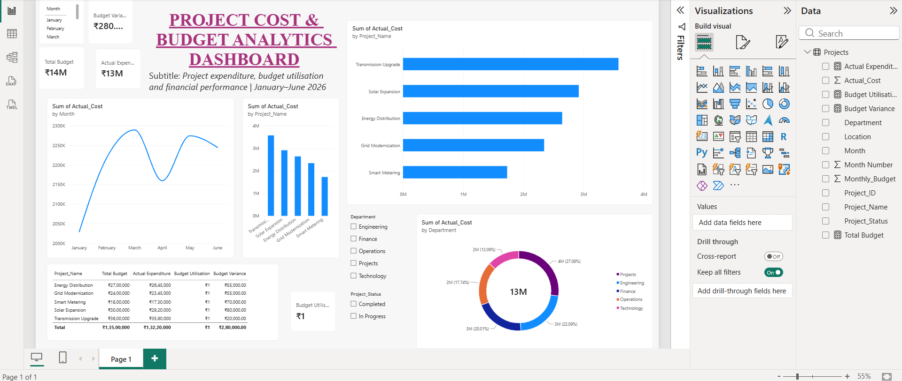

# Project Cost & Budget Analytics Dashboard

## Overview
## 🖥️ Dashboard Preview



The **Project Cost & Budget Analytics Dashboard** is an interactive Power BI project developed to monitor project budgets, analyse actual expenditure, and track budget utilisation across multiple departments and projects.

The dashboard helps users understand project-level financial performance, identify budget overruns, and monitor monthly expenditure through interactive visualisations and key performance indicators (KPIs).

## Project Objectives

- Monitor allocated budgets against actual project expenditure.
- Analyse budget utilisation and financial variance.
- Compare expenditure across different projects.
- Track monthly expenditure trends.
- Identify projects exceeding their allocated budgets.
- Support data-driven financial monitoring and decision-making.

## Tools & Technologies

- **Microsoft Power BI** – Dashboard development and data visualisation.
- **Microsoft Excel** – Dataset preparation and organisation.
- **DAX (Data Analysis Expressions)** – Calculated measures and financial KPIs.

## Dashboard Features

### Key Performance Indicators
- Total Budget
- Actual Expenditure
- Budget Variance
- Budget Utilisation (%)

### Visualisations
- Monthly Expenditure Trend – Tracks expenditure from January to June.
- Project-wise Cost Comparison – Compares actual expenditure across projects.
- Department-wise Expenditure – Displays expenditure distribution by department.
- Project Budget Analysis – Provides a financial summary of individual projects.

### Interactive Filters
- Department
- Project Status

## DAX Measures

**1. Total Budget**
```dax
Total Budget = SUM(Projects[Monthly_Budget])
```

**2. Actual Expenditure**
```dax
Actual Expenditure = SUM(Projects[Actual_Cost])
```

**3. Budget Variance**
```dax
Budget Variance = [Total Budget] - [Actual Expenditure]
```

**4. Budget Utilisation**
```dax
Budget Utilisation = DIVIDE([Actual Expenditure], [Total Budget], 0)
```

## Dataset Description

The dataset contains simulated project financial records covering six months (January–June) across five projects and multiple departments.

It includes:
- Project ID
- Project Name
- Department
- Location
- Month
- Monthly Budget
- Actual Cost
- Project Status

**Note:** This is a synthetic dataset created for educational and portfolio demonstration purposes. It does not contain actual company financial data.

## Key Business Insights

The dashboard enables users to:
- Identify projects with expenditure exceeding allocated budgets.
- Compare planned budgets with actual spending.
- Monitor department-level expenditure patterns.
- Track monthly changes in project costs.
- Support budget monitoring and cost-control decisions.

## Skills Demonstrated

- Data Cleaning and Preparation
- Data Modelling
- DAX Measures
- KPI Development
- Interactive Dashboard Design
- Financial Data Analysis
- Business Intelligence
- Data Visualisation

## Repository Structure

```text
Project-Cost-Budget-Analytics/
│
├── Project_Cost_Budget_Analytics.pbix
├── Project_Cost_Analytics.xlsx
├── Dashboard_Screenshot.png
└── README.md
```

## How to Use

1. Download the `.pbix` Power BI file.
2. Open it using Microsoft Power BI Desktop.
3. Explore the dashboard and its interactive filters.
4. Use the Excel dataset to review the underlying project records.

---

**Developed as a Business Intelligence and Data Analytics portfolio project.**
